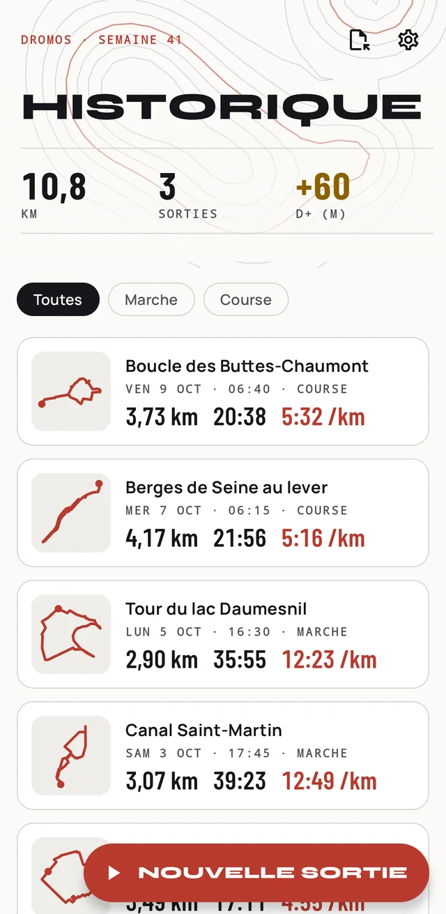
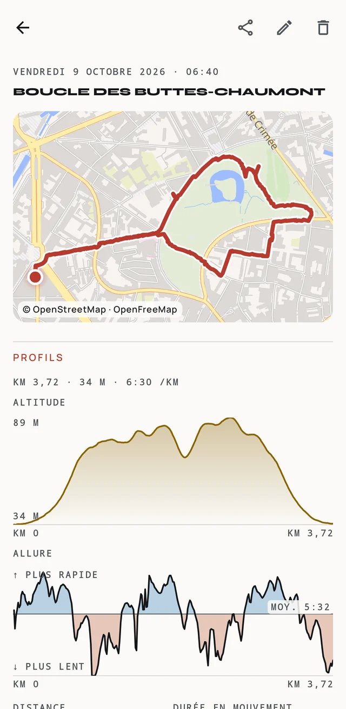
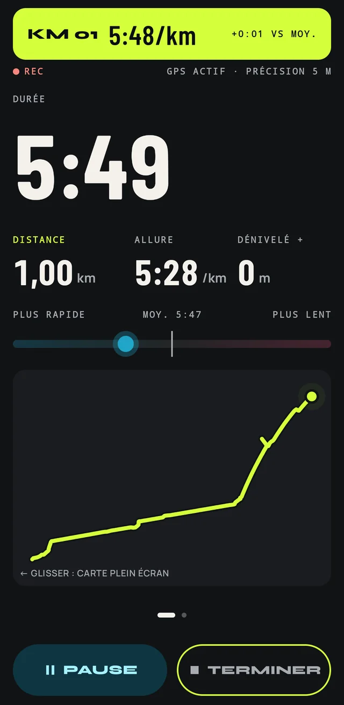
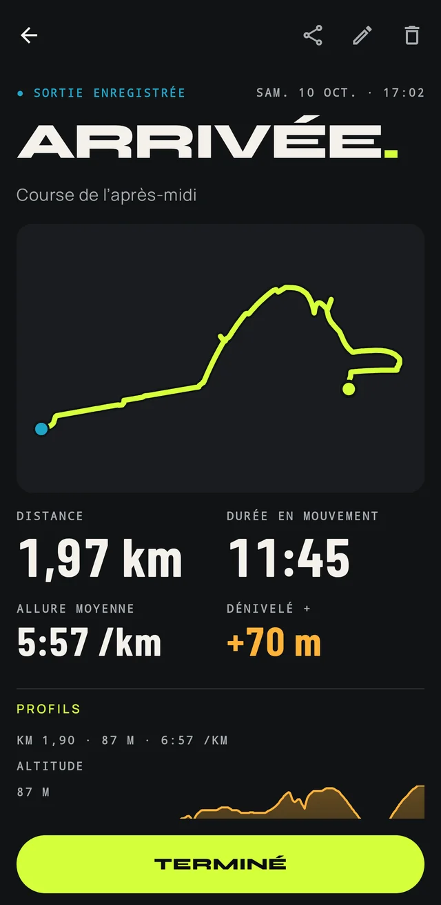

<p align="center">
  
</p>

<h1 align="center">Dromos</h1>

<p align="center"><b>Le carnet de course et de marche qui reste dans ta poche.</b><br>
GPS hors-ligne · sans compte ni cloud · aucun service Google</p>

<p align="center">
  
  
  
  
</p>

---

Dromos enregistre tes sorties à pied (marche et course) par GPS, les analyse et les garde sur ton
téléphone. Pas de compte, pas de cloud, pas de services Google : tes tracés t'appartiennent.

## Fonctionnalités

**Pendant la sortie**
- Suivi GPS en temps réel, même écran éteint : distance, durée, allure instantanée et moyenne,
  dénivelé (baromètre si le téléphone en a un).
- Pause automatique aux feux rouges, pause manuelle, reprise après une coupure de l'appli.
- Compte à rebours, passage de chaque kilomètre annoncé par un bandeau et une double vibration,
  jauge d'allure face à la moyenne, carte plein écran d'un glissement.

**Après la sortie**
- Historique local avec la semaine en cours, filtres Course / Marche.
- Détail : carte, totaux, splits au kilomètre, profils d'altitude et d'allure avec un curseur
  synchronisé à la carte.
- Export GPX et KML (partage ou fichier), import GPX d'une ou plusieurs traces.

**Pour tout le monde**
- Trois palettes (Corail, Signal, Nocturne pour courir de nuit), thème clair ou sombre.
- Lisible avec TalkBack et en très grande police ; couleurs distinctes pour les daltoniens.
- Ambiance « Sobre » et respect du réglage Android « Supprimer les animations ».

## Installer

Télécharge `Dromos-vX.Y.Z.apk` depuis la [dernière release](https://github.com/SlashXIV/dromos/releases/latest)
et ouvre-le sur ton téléphone (Android 8 ou plus). Les versions suivantes s'installent par-dessus,
sans perdre tes sorties.

## Vie privée

- Tes sorties ne quittent jamais le téléphone sans action explicite de ta part (export, partage).
- Aucune télémétrie, aucune publicité, aucun compte.
- La localisation n'est utilisée que pendant une sortie, via une notification visible.
- Seule requête réseau : le fond de carte. Les tuiles OpenStreetMap sont téléchargées depuis
  [OpenFreeMap](https://openfreemap.org), ce qui leur révèle la zone affichée. Désactive
  « Fond de carte en ligne » dans les Réglages pour ne plus rien envoyer : seul le tracé est
  alors dessiné.

## Compiler

Prérequis : JDK 17 ou plus (le `jbr` d'Android Studio convient).

```sh
./gradlew testDebugUnitTest :core:domain:test :core:gpx:test lintDebug assembleDebug
```

## Crédits

Cartes : © contributeurs [OpenStreetMap](https://www.openstreetmap.org/copyright), tuiles
[OpenFreeMap](https://openfreemap.org), rendu [MapLibre](https://maplibre.org).

## Licence

[AGPL-3.0](LICENSE).
